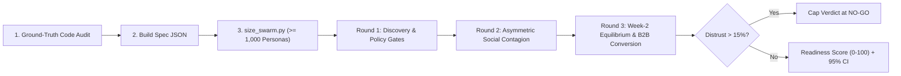

# 🎯 pulse-crowd

> **Understand the market—and your in-app UX—before you ship.** Adaptive multi-round virtual crowd & UX funnel simulation (`1,000` to `25,000+` personas) for AI coding agents — catch where users get **stuck**, **distracted**, or **lost** inside your app, stress-test **e-commerce & dropshipping** conversion, and validate pricing & compliance before launch.

**English** · [Español](docs/i18n/README.es.md) · [简体中文](docs/i18n/README.zh-CN.md) · [日本語](docs/i18n/README.ja.md) · [한국어](docs/i18n/README.ko.md) · [Français](docs/i18n/README.fr.md) · [Deutsch](docs/i18n/README.de.md) · [Português](docs/i18n/README.pt-BR.md) · [Italiano](docs/i18n/README.it.md) · [हिन्दी](docs/i18n/README.hi.md) · [Русский](docs/i18n/README.ru.md)

[](https://github.com/SamuelCoreLabs/pulse-crowd/actions/workflows/ci.yml)
[](https://github.com/SamuelCoreLabs/pulse-crowd/releases)


[](https://github.com/SamuelCoreLabs/pulse-crowd)

**[📊 Live Interactive Demo](https://samuelcorelabs.github.io/pulse-crowd/)** · **[📦 GitHub Releases](https://github.com/SamuelCoreLabs/pulse-crowd/releases)** · **[🌱 Good First Issues](https://github.com/SamuelCoreLabs/pulse-crowd/issues?q=is%3Aissue+is%3Aopen+label%3A%22good+first+issue%22)** · **[🐛 Report Bug](https://github.com/SamuelCoreLabs/pulse-crowd/issues)**


---

## Why PulseCrowd?

| Approach | Sample Size | Minority Risk Detection | Determinism & CI | Portability |
| :--- | :--- | :--- | :--- | :--- |
| **Single LLM launch prompt** | 1 generic persona | Hides compliance & cold-start edges | None | Prompt only |
| **Static 10–15 persona script** | Fixed ~15 personas | Oversimplifies or wastes scale | Ad-hoc | Tool-locked |
| **`pulse-crowd` (This Skill)** | **Adaptive `1,000` – `25,000+`** | **Stratified + Largest Remainder floor** | **Seeded Monte Carlo 95% CI** | **Claude, Codex, Gemini CLI, OpenCode, Cursor, Antigravity** |

### Case Study 1: In-App UX + Dropshipping Store vs. Hardened DTC Store (`v2.0`)

Simulated directly via `scripts/simulate_crowd.py --runs 3 --seed 42` across `4,800–4,900` virtual personas walking screen-by-screen (`Ad Landing → Cart Drawer → Account/Shipping → Checkout`):

| Metric | Broken Dropshipping ([`dropshipping-store.json`](examples/dropshipping-store.json)) | Hardened DTC Brand ([`ecommerce-dtc-brand.json`](examples/ecommerce-dtc-brand.json)) |
| :--- | :--- | :--- |
| **Readiness Score** | **`14.0 / 100`** (`NO-GO`) | **`95.1 / 100`** (`GO`) |
| **End-to-End UX Completion** | **`3.6%`** | **`74.9%`** |
| **#1 UX Bottleneck Route** | `app/checkout/shipping-step.tsx` (`70.0%` drop · `trust_or_price_shock`) | `components/CartDrawer.tsx` (`10.3%` drop · `distracted`) |
| **Add-to-Cart / Store CVR** | `2.2%` ATC · `0.15%` CVR (`93.3%` abandon) | `13.0%` ATC · `4.67%` CVR (`63.9%` abandon) |
| **Ad Break-Even Max CPC** | **`$0.04`** *(burns money at `$0.95` CPC)* | **`$2.51`** *(profitable at `$0.85` CPC)* |

### Case Study 2: Regulated Marketplace Launch (`6,750` Virtual Personas)

Simulated directly via `scripts/simulate_crowd.py` (`--runs 3 --seed 42`) on a two-sided youth sports marketplace before vs. after fixing heavy KYC friction, minor/privacy compliance gaps, and negative pricing sentiment:

| Metric | Pre-Hardening Baseline | Post-Hardening ([`regulated-marketplace.json`](examples/regulated-marketplace.json)) |
| :--- | :--- | :--- |
| **Adaptive Population** | `6,750` personas (`complex_4k_8k`) | `6,750` personas (`complex_4k_8k`) |
| **Readiness Score** | **`11.7 / 100`** (`±0.35 CI95`) | **`92.3 / 100`** (`±0.07 CI95`) |
| **Sentiment (`R1 → R2 → R3`)** | `-0.473 → -0.681 → -0.443` | `+0.452 → +0.530 → +0.649` |
| **Retained vs. Rejected** | `22` active · `832` stalled · `5,838` distrust rejections | `6,583` active/advocates · `1` stalled · `0` distrust rejections |
| **Verdict** | **NO-GO** *(Critical Blockers Trigger Rejection Spiral)* | **GO** *(Conditional or Phase-1 Launch Ready)* |

> Try tuning those exact parameters yourself right in the browser: **[Live Interactive Demo →](https://samuelcorelabs.github.io/pulse-crowd/)**

### The Problem

Asking an AI assistant to "simulate a launch" in a single prompt—or testing a product against 10–15 synthetic personas—misses structural market dynamics:

- Small sample prompts hide minority failure modes (legal auditors, regional cold-start zones, skeptical power users, or guardian verification friction).
- Fixed, oversized test runs waste compute on simple developer utilities that only need a focused cohort mix.
- Proprietary single-tool orchestration scripts break across other AI assistants.

`pulse-crowd` packages a **portable Agent Skill** (`SKILL.md` + zero-dependency Python 3 stdlib tooling) that sizes the virtual crowd automatically **before** dispatch and runs deterministic multi-round simulations across **at least 1,000 virtual personas**. It works on codebases in **any programming language** (TypeScript, Next.js, Python, Go, Rust, Java, Swift, PHP) and responds in **any human language** you prompt your AI assistant in.

---

## How It Works



1. **Pre-Dispatch Adaptive Swarm Sizing (`scripts/size_swarm.py`):** Evaluates project complexity across product architecture (including `ecommerce_brand` & `dropshipping_store`), target segments, geographic footprint, pricing tiers, acquisition channels, regulatory risk, UX journey steps, lifecycle stage, and desired depth. Enforces a strict **minimum floor of 1,000 virtual personas** up to **25,000+**.
2. **Stratified Cohort Allocation:** Uses Largest Remainder allocation with a per-cohort statistical power floor so critical minority cohorts (such as compliance reviewers or skeptical price comparators) remain measurable.
3. **Three-Round Agent-Based Contagion Simulation (`scripts/simulate_crowd.py`):**
   - **Round 1 — Discovery & Policy Gates:** Models onboarding friction, regulatory/privacy barriers, pricing fairness, and baseline value fit per virtual individual.
   - **Round 2 — Asymmetric Social Contagion:** Simulates peer-cluster alignment and public discourse spillovers, applying higher negative weight when unresolved compliance or trust complaints arise.
   - **Round 3 — Week-2 Equilibrium & Conversion:** Simulates regional liquidity gaps, retention outcomes, B2B Basic/Pro conversion hurdles, and Monte Carlo 95% confidence intervals across seeds.
4. **In-App UX Journey Traversal (`ux_journey`):** Simulates every virtual user walking screen-by-screen through your real app routes (`Landing → Signup/PDP → Cart → Checkout`) to pinpoint exact bottlenecks where users get **stuck** (`step_friction`), **distracted** (`distraction_load`), **lost** (`confusion_risk`), or hit **trust/price shocks** (`surprise_cost`).
5. **E-Commerce & Dropshipping Unit Economics (`commerce_profile`):** Models delivery-window penalties, hidden checkout shipping shocks, Add-to-Cart %, Cart Abandonment %, Store CVR, Simulated CPA, and Break-Even Max CPC.
6. **Transparent Readiness Scoring:** Produces a `0–100` Readiness Score with an explicit regulatory distrust safety gate (`rejected_distrust > 15%` caps verdict at `NO-GO`).

---

## Project Structure

```text
pulse-crowd/
├── SKILL.md                          # Core Agent Skills instructions and workflow
├── README.md                         # Project documentation
├── pyproject.toml                    # Zero-dependency Python packaging & CLI entry points
├── LICENSE                           # MIT License
├── CHANGELOG.md                      # Release history
├── CONTRIBUTING.md                   # Contribution and testing guidelines
├── CODE_OF_CONDUCT.md                # Contributor Covenant Code of Conduct
├── SECURITY.md                       # Private vulnerability reporting policy
├── assets/
│   └── demo-preview.svg              # Architecture & observed benchmark preview
├── docs/
│   ├── index.html                    # Interactive GitHub Pages web demo
│   └── i18n/                         # README translations (ES, ZH, JA, KO, FR, DE, PT-BR, IT, HI, RU)
├── .github/
│   ├── CODEOWNERS                    # Maintainer review enforcement
│   ├── dependabot.yml                # Automated GitHub Actions updates
│   ├── PULL_REQUEST_TEMPLATE.md      # Pull request checklist
│   ├── ISSUE_TEMPLATE/               # Structured bug, feature & Q&A templates
│   └── workflows/                    # CI matrix (Python 3.9–3.14) & PyPI release
├── scripts/
│   ├── scaffold_spec.py              # Interactive & CLI business spec generator (6 verticals + custom)
│   ├── size_swarm.py                 # Adaptive >= 1,000 population sizing calculator
│   ├── simulate_crowd.py             # 3-round + UX funnel crowd simulator + reporting
│   └── validate_skill.py             # SKILL.md spec, link, schema, and secret checker
├── references/
│   ├── audience-playbooks.md         # Vertical playbooks (dropshipping, DTC, future apps/webs, SaaS)
│   ├── methodology.md                # Mathematical formulation, rubric, and scope limits
│   └── spec-schema.json              # JSON Schema for project, UX journey & commerce specs
├── examples/
│   ├── minimal-b2b-cli.json          # Lean dev-tool spec (sizes to 1,500 personas)
│   ├── regulated-marketplace.json    # Complex regional marketplace spec (sizes to 6,750 personas)
│   ├── dropshipping-store.json       # High-friction dropshipping + UX funnel (14.0 NO-GO)
│   ├── ecommerce-dtc-brand.json      # Hardened DTC store + unit economics (95.1 GO)
│   └── website-lead-funnel.json      # Future website / lead-gen landing funnel concept
└── tests/
    └── test_pulse_crowd_sim.py       # Python unittest suite (11 tests)
```

---

## Requirements & Dependencies

- **Runtime:** Python `3.9+` (tested locally on `Python 3.9.6` and verified in CI across `3.9`–`3.14`).
- **External packages:** None. All core scripts use Python's standard library (`json`, `csv`, `math`, `random`, `statistics`, `argparse`, `pathlib`, `unittest`, `re`).
- **Optional CLI:** Node.js / `npx` if installing via the community `skills` CLI (`npx skills add`).

---

## Installation

Replace `SamuelCoreLabs` with your GitHub username or organization if forking.

### Option 1: Install Globally via `npx skills` (Multi-Agent CLI)

Per Vercel Labs' [`skills`](https://github.com/vercel-labs/skills) CLI documentation (`-g` installs globally at the user level):

```bash
# Interactive multi-agent global install
npx skills add SamuelCoreLabs/pulse-crowd -g

# Target specific agents non-interactively
npx skills add SamuelCoreLabs/pulse-crowd -a claude-code -g -y
npx skills add SamuelCoreLabs/pulse-crowd -a codex -g -y
npx skills add SamuelCoreLabs/pulse-crowd -a opencode -g -y
```

### Option 2: Manual Global Installation (Clone / Symlink)

Clone the repository once, then link or copy it to the shared standard path (`~/.agents/skills/`) and any agent-native directories you use:

```bash
git clone https://github.com/SamuelCoreLabs/pulse-crowd.git ~/skills/pulse-crowd
mkdir -p ~/.agents/skills ~/.claude/skills ~/.codex/skills ~/.config/opencode/skills

# Shared Agent Skills path (scanned by Codex, OpenCode, Gemini CLI, Cursor)
ln -sfn ~/skills/pulse-crowd ~/.agents/skills/pulse-crowd

# Agent-specific user-level skill directories
ln -sfn ~/skills/pulse-crowd ~/.claude/skills/pulse-crowd
ln -sfn ~/skills/pulse-crowd ~/.codex/skills/pulse-crowd
ln -sfn ~/skills/pulse-crowd ~/.config/opencode/skills/pulse-crowd
```

For workspace-only installation inside a single repository instead of global installation, place the folder under `.agents/skills/pulse-crowd/` (or `.claude/skills/pulse-crowd/`).

### Option 3: Install Python CLI via `pip` (from GitHub)

```bash
pip install git+https://github.com/SamuelCoreLabs/pulse-crowd.git
pulse-crowd-size --spec examples/minimal-b2b-cli.json
pulse-crowd-sim --spec examples/regulated-marketplace.json --out-dir /tmp/pulse_crowd_demo --runs 3 --seed 42
```

### Verify Your Installation

Confirm the skill directory resolves cleanly and passes self-checks:

```bash
python3 ~/.agents/skills/pulse-crowd/scripts/validate_skill.py
python3 -m unittest discover -s ~/.agents/skills/pulse-crowd/tests -v
```

Expected confirmation: `Skill validation PASSED` and `Ran 11 tests ... OK`.

---

## Usage & Observed CLI Examples

### 1. Adaptive Sizing Check (Run Before Simulation)

Compare how the same sizing engine scales virtual traffic automatically for a small CLI tool vs. a regulated two-sided marketplace:

```bash
# Minimal single-city developer CLI -> sizes cleanly above the 1,000 floor (1,500)
python3 scripts/size_swarm.py --spec examples/minimal-b2b-cli.json

# Regulated regional two-sided marketplace -> scales upward automatically (6,750)
python3 scripts/size_swarm.py --spec examples/regulated-marketplace.json
```

### 2. Full 3-Round Crowd Simulation

```bash
python3 scripts/simulate_crowd.py \
  --spec examples/regulated-marketplace.json \
  --out-dir /tmp/pulse_crowd_demo_reg \
  --runs 3 \
  --seed 42
```

Verified output observed on `Python 3.9.6`:

```json
{
  "project_name": "Regional Youth Sports Scouting Marketplace (Post-Hardening)",
  "recommended_population": 6750,
  "complexity_tier": "complex_4k_8k",
  "monte_carlo": {
    "runs": 3,
    "base_seed": 42,
    "mean_readiness_score": 92.3,
    "score_ci95_half_width": 0.07,
    "mean_avg_r1": 0.452,
    "mean_avg_r2": 0.53,
    "mean_avg_r3": 0.649,
    "verdict": "GO (Conditional or Phase-1 Launch Ready)"
  },
  "out_dir": "/tmp/pulse_crowd_demo_reg"
}
```

And on the minimal tool (`examples/minimal-b2b-cli.json`): `recommended_population: 1500` (`lean_1k`), `mean_readiness_score: 90.0` (`±0.07`).

Run the v2.0 **Dropshipping & In-App UX Funnel** simulation:

```bash
python3 scripts/simulate_crowd.py \
  --spec examples/dropshipping-store.json \
  --out-dir /tmp/pulse_crowd_dropship \
  --runs 3 \
  --seed 42
```

Generated output artifacts in `--out-dir`:
- `sizing_plan.json` — weighted complexity drivers and proportional cohort allocations
- `metrics.json` — Monte Carlo summary, outcomes distribution, optional `ux_funnel` bottleneck breakdown (`stuck`/`distracted`/`lost`/`trust_or_price_shock`), and optional `commerce_kpis`
- `cohorts_summary.csv` — tabular breakdown per cohort
- `personas_sample.json` — stratified individual trace sample including per-step drop locations
- `report.md` — structured launch report with screen-by-screen UX drop-off table & unit economics

### 3. Prompting Your AI Agent Naturally

Once installed globally, you can simply invoke the skill (`"run pulse-crowd"`) or describe your project:

- *"Run pulse-crowd"* — the agent automatically asks what business you are building (*dropshipping, e-commerce, future app, future website, SaaS, marketplace, or other custom project*), asks 3–5 tailored questions, and runs the full simulation to help you!
- *"Audit every screen of our onboarding and checkout flow, detect where users get stuck, distracted, or lost across >= 1,000 virtual personas, and pinpoint the exact React/Liquid components to fix."*
- *"Simulate 4,000+ TikTok/Meta visitors on our dropshipping store (`aov`, shipping window, cart popups) and compute our break-even max CPC."*
- Or launch the interactive wizard directly in your terminal:
  ```bash
  python3 scripts/scaffold_spec.py --interactive --lang en --out /tmp/my_spec.json
  ```

### Expected Agent Workflow

When activated, a compatible agent will:
1. **Step 0 — Guided Business Intake:** Ask which business vertical & stage you are targeting (*Dropshipping Store*, *DTC E-Commerce*, *Future Mobile/Web App*, *Future Website / Lead Funnel*, *B2B SaaS*, *Marketplace*, or *Other / Custom Project*) and ask tailored questions if details are missing.
2. Inspect your real codebase/store routes (if available) or scaffold from [references/audience-playbooks.md](references/audience-playbooks.md) and `scripts/scaffold_spec.py` following [references/spec-schema.json](references/spec-schema.json).
3. Run `scripts/size_swarm.py` to compute adaptive traffic (`>= 1,000`).
4. Execute `scripts/simulate_crowd.py` across multiple seeds and present UX bottlenecks (`stuck`, `distracted`, `lost`), unit economics, and tailored fixes in your language.

---

## Agent & Tool Compatibility Matrix

| Agent / Tool | Discovery Paths | Verification Status | Notes |
| :--- | :--- | :--- | :--- |
| **Antigravity IDE / CLI** | `.agents/skills/`, configured `skills.json` | **Confirmed (tested locally)** | Validated `SKILL.md` loading conventions and local script execution on macOS. |
| **Claude Code** | `~/.claude/skills/`, `.claude/skills/` | **Confirmed layout / Pending live CLI test** | Global directory inspected locally; conforms to `agentskills.io` `SKILL.md` format documented for Claude Code. |
| **OpenAI Codex CLI** | `~/.codex/skills/`, `~/.agents/skills/` | **Documented compatible / Untested live** | Follows official Codex skill discovery paths and stdlib shell execution. |
| **OpenCode** | `~/.config/opencode/skills/`, `~/.agents/skills/`, `~/.claude/skills/` | **Documented compatible / Untested live** | Scans OpenCode, Claude, and shared `.agents/skills/` directories natively. |
| **Gemini CLI** | `~/.gemini/skills/`, `~/.agents/skills/` | **Documented compatible / Untested live** | Follows `agentskills.io` spec and shared global path conventions. |
| **Cursor** | `~/.cursor/skills/`, `~/.agents/skills/` | **Documented compatible / Untested live** | Supports `SKILL.md` progressive disclosure per Cursor skills documentation. |

---

## Limitations & When Not to Use

- **Synthetic sensitivity model, not field telemetry:** Output scores measure directional sensitivity to calibrated assumptions (onboarding friction, regulatory exposure, regional density, paywall limits). They do **not** predict actual revenue or conversion rates in production.
- **Garbage-in, garbage-out calibration:** If the input JSON uses optimistic `value_fit` or ignores real codebase defects, simulation results will reflect optimistic assumptions. Always ground inputs in code and user research.
- **Not a substitute for legal, medical, or usability review:** The simulator models stakeholder pushback to compliance issues but does not provide legal clearance (GDPR, COPPA, LOPIVI) or replace moderated usability testing.
- **When not to use:** Do not use for purely internal library refactoring where there is no end-user onboarding, pricing, compliance, or adoption decision.

---

## Privacy & Security

- Runs 100% locally via Python 3 standard library—no telemetry, no external network calls, and no API keys required.
- All bundled specs in `examples/` are anonymized illustrative templates with zero personal identifiable information (PII).
- Automated CI/local validation (`scripts/validate_skill.py`) scans files for common secret patterns before distribution.

---

## Contributing

Contributions are welcome! Check our **[Good First Issues](https://github.com/SamuelCoreLabs/pulse-crowd/issues?q=is%3Aissue+is%3Aopen+label%3A%22good+first+issue%22)**, review [CONTRIBUTING.md](CONTRIBUTING.md) and our [Code of Conduct](CODE_OF_CONDUCT.md), and run both checks before opening a pull request:

```bash
python3 scripts/validate_skill.py
python3 -m unittest discover -s tests -v
```

---

## License

Licensed under the **[MIT License](LICENSE)** — Copyright (c) 2026 SamuelCoreLabs.

**Why MIT?** For an open-source Agent Skill targeting broad developer and multi-agent adoption (`npx skills`, Claude Code, Codex, OpenCode), the MIT License offers minimal legal friction for commercial teams, solo developers, and forks while requiring only preservation of the copyright and permission notice.
