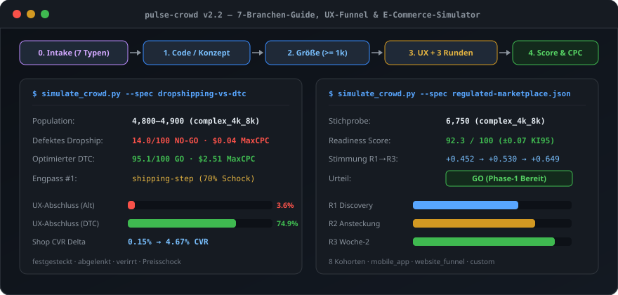

# 🎯 pulse-crowd

> **Markt und In-App-UX verstehen, bevor Sie live gehen.** Geführte, adaptive virtuelle Crowd- & UX-Funnel-Simulation (`1.000` bis `25.000+` Personas) für KI-Coding-Agents — fragt nach Ihrem Geschäftsmodell (*Dropshipping, DTC-E-Commerce, geplante App/Website vor dem Code, B2B-SaaS, Marktplatz oder Custom-Projekt*), zeigt genau, wo Nutzer **hängen bleiben**, **abgelenkt werden** oder **sich verlaufen**, und berechnet CVR & **Break-Even Max CPC** vor dem Ad-Spend.

[English](../../README.md) · [Español](README.es.md) · [简体中文](README.zh-CN.md) · [日本語](README.ja.md) · [한국어](README.ko.md) · [Français](README.fr.md) · **Deutsch** · [Português](README.pt-BR.md) · [Italiano](README.it.md) · [हिन्दी](README.hi.md) · [Русский](README.ru.md)

[](https://github.com/SamuelCoreLabs/pulse-crowd/actions/workflows/ci.yml)
[](https://github.com/SamuelCoreLabs/pulse-crowd/releases)


**[📊 Interaktive Live-Demo](https://samuelcorelabs.github.io/pulse-crowd/)** · **[📦 Releases](https://github.com/SamuelCoreLabs/pulse-crowd/releases)** · **[🌱 Good First Issues](https://github.com/SamuelCoreLabs/pulse-crowd/issues?q=is%3Aissue+is%3Aopen+label%3A%22good+first+issue%22)**



---

## Warum PulseCrowd?

| Ansatz | Stichprobengröße | Erkennung von Minderheitsrisiken | Determinismus & CI | Portabilität |
| :--- | :--- | :--- | :--- | :--- |
| **Einzelner LLM-Prompt** | 1 generische Persona | Verbirgt Compliance- & Cold-Start-Risiken | Keiner | Nur Prompt |
| **Fixes 10–15 Personas Skript** | Fix ~15 Personas | Übervereinfacht oder unflexibel | Ad-hoc | Tool-gebunden |
| **`pulse-crowd` (Dieser Skill)** | **Adaptiv `1.000` – `25.000+`** | **Stratifiziert mit statistischem Minimum** | **Monte-Carlo-95%-Konfidenzintervall** | **Claude, Codex, Gemini CLI, OpenCode, Cursor, Antigravity** |

### Schritt 0: Geführtes Business-Intake & 7 Branchen (`v2.1` – `v2.2`)
Starten Sie `"run pulse-crowd"` (oder `python3 scripts/scaffold_spec.py --interactive`): Der Skill fragt zuerst nach Ihrem **Geschäftsmodell** und ob bereits **Code/Shopify-Dateien** existieren oder ein **Pre-Code-Konzept** geprüft wird ([audience-playbooks.md](../../references/audience-playbooks.md)):
1. **Dropshipping-Shop** (`dropshipping_store`) — kaltes TikTok/Meta-Traffic-Modell, `10–25` Tage Lieferzeit, Popups, versteckte Versandkosten, **Break-Even Max CPC**.
2. **E-Commerce / DTC-Marke** (`ecommerce_brand`) — Größen-/Materialfragen, Rückgaberecht, Slide-Cart, Express-Checkout, ATC, CVR & CPA.
3. **Geplante Mobile-/Web-App** *(Pre-Code)* (`mobile_app`) — First-Screen-Hook, erzwungenes Signup/KYC, Berechtigungen, Paywall.
4. **Geplante Website / Lead-Funnel** *(Pre-Code)* (`website_funnel`) — Hero-Klarheit, Social Proof, transparente Preise, Lead-/Buchungsformular.
5. **B2B-SaaS & Developer-Tools** (`b2b_saas` / `developer_tool`) — Docs, Auth/Trial, erster API-Call/Workspace, *Basic* vs *Pro*-Conversion.
6. **Zweiseitiger Marktplatz / Regulierte Plattform** (`two_sided_marketplace` / `regulated_platform`) — lokale Liquidität, DSGVO/KYC, `> 15%`-Safety-Gate.
7. **Anderes / Custom-Projekt (`v2.2`)** (`custom_project`) — Browser-Extensions, Discord/Telegram-Bots, Kurse, Newsletter, Indie-Games oder lokale Services.

### Fallstudie: High-Friction Dropshipping vs. optimierter DTC-Shop (`v2.0+`)
| Metrik | Dropshipping mit Reibung ([`dropshipping-store.json`](../../examples/dropshipping-store.json)) | Optimierter DTC-Shop ([`ecommerce-dtc-brand.json`](../../examples/ecommerce-dtc-brand.json)) |
| :--- | :--- | :--- |
| **Readiness Score** | **`14.0 / 100`** (`NO-GO`) | **`95.1 / 100`** (`GO`) |
| **UX-Funnel Abschluss** | **`3.6%`** (`shipping-step` `70.0%` Preisschock) | **`74.9%`** (`CartDrawer` `10.3%` Ablenkung) |
| **Store CVR / Max CPC** | `0.15%` CVR · **`$0.04`** *(Verlust bei `$0.95`)* | `4.67%` CVR · **`$2.51`** *(profitabel bei `$0.85`)* |

### Funktionen
1. **Adaptives Sizing (`scripts/size_swarm.py`):** Strikter Mindestwert **`1.000` Personas** bis **`25.000+`**.
2. **Stratifizierte Kohorten-Verteilung:** Hare-Niemeyer-Verfahren für rechtliche Prüfer und preissensible Kritiker.
3. **3-Runden-Simulation (`scripts/simulate_crowd.py`):** Discovery → Asymmetrische soziale Ansteckung → Woche-2-Gleichgewicht & 95%-KI.
4. **In-App UX-Funnel (`ux_journey`):** Trennt **Festgesteckt** (`stuck`), **Abgelenkt** (`distracted`), **Verirrt** (`lost`) & **Preis-/Vertrauensschock**.
5. **E-Commerce Unit Economics (`commerce_profile`):** Add-to-Cart, Warenkorbabbruch, CVR, simulierter CPA & Break-Even Max CPC.
6. **Klares Sicherheits-Gate (`0–100`):** `rejected_distrust > 15%` setzt Urteil automatisch auf `NO-GO`.

---

## Schnellinstallation

### Option 1: Global via `npx skills`
```bash
npx skills add SamuelCoreLabs/pulse-crowd -g
```

### Option 2: Manuell via Git + Symlink
```bash
git clone https://github.com/SamuelCoreLabs/pulse-crowd.git ~/skills/pulse-crowd
mkdir -p ~/.agents/skills ~/.claude/skills ~/.codex/skills ~/.config/opencode/skills
ln -sfn ~/skills/pulse-crowd ~/.agents/skills/pulse-crowd
ln -sfn ~/skills/pulse-crowd ~/.claude/skills/pulse-crowd
ln -sfn ~/skills/pulse-crowd ~/.codex/skills/pulse-crowd
ln -sfn ~/skills/pulse-crowd ~/.config/opencode/skills/pulse-crowd
```

### Option 3: Python-CLI via `pip`
```bash
pip install git+https://github.com/SamuelCoreLabs/pulse-crowd.git
pulse-crowd-init --interactive --lang en --out /tmp/my_project_spec.json
pulse-crowd-size --spec examples/minimal-b2b-cli.json
pulse-crowd-sim --spec examples/dropshipping-store.json --out-dir /tmp/pulse_crowd_demo --runs 3 --seed 42
```

### Lokal prüfen
```bash
python3 scripts/validate_skill.py
python3 -m unittest discover -s tests -v
```

---

## Dokumentation & Community

- **Agent-Skill-Spezifikation:** [SKILL.md](../../SKILL.md) · **JSON-Schema:** [spec-schema.json](../../references/spec-schema.json) · **Methodik:** [methodology.md](../../references/methodology.md)
- **Mitwirken:** [CONTRIBUTING.md](../../CONTRIBUTING.md) · **Verhaltenskodex:** [CODE_OF_CONDUCT.md](../../CODE_OF_CONDUCT.md) · **Sicherheit:** [SECURITY.md](../../SECURITY.md) · **Lizenz:** [MIT](../../LICENSE)
