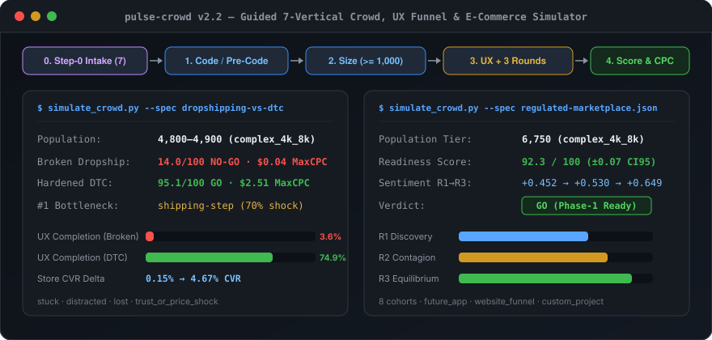

# 🎯 pulse-crowd

> **Comprenez le marché avant d'y entrer.** Simulation adaptative multi-tours de foules virtuelles (`1 000` à `25 000+` personas) pour agents de code IA — testez vos lancements, parcours d'onboarding, grilles tarifaires et risques de conformité avant la mise en production.

[English](../../README.md) · [Español](README.es.md) · [简体中文](README.zh-CN.md) · [日本語](README.ja.md) · [한국어](README.ko.md) · **Français** · [Deutsch](README.de.md) · [Português](README.pt-BR.md) · [Italiano](README.it.md) · [हिन्दी](README.hi.md) · [Русский](README.ru.md)

[](https://github.com/SamuelCoreLabs/pulse-crowd/actions/workflows/ci.yml)
[](https://github.com/SamuelCoreLabs/pulse-crowd/releases)


**[📊 Démo Interactive en Ligne](https://samuelcorelabs.github.io/pulse-crowd/)** · **[📦 Releases GitHub](https://github.com/SamuelCoreLabs/pulse-crowd/releases)** · **[🌱 Good First Issues](https://github.com/SamuelCoreLabs/pulse-crowd/issues?q=is%3Aissue+is%3Aopen+label%3A%22good+first+issue%22)**



---

## Pourquoi PulseCrowd ?

| Approche | Taille d'échantillon | Détection des risques minoritaires | Déterminisme & IC | Portabilité |
| :--- | :--- | :--- | :--- | :--- |
| **Prompt LLM unique** | 1 persona générique | Masque conformité et zones froides | Aucun | Prompt seul |
| **Script fixe de 10–15 personas** | ~15 personas fixes | Sous-représentatif ou rigide | Ad-hoc | Verrouillé |
| **`pulse-crowd` (Cette Skill)** | **Adaptatif `1 000` – `25 000+`** | **Stratifié avec plancher statistique** | **Monte Carlo déterministe IC 95 %** | **Claude, Codex, Gemini CLI, OpenCode, Cursor, Antigravity** |

### Fonctionnalités principales
1. **Dimensionnement adaptatif préalable (`scripts/size_swarm.py`) :** Évalue l'architecture produit, les segments, la couverture géographique, les paliers tarifaires et le risque réglementaire en garantissant un **minimum strict de `1 000` personas** jusqu'à **`25 000+`**.
2. **Allocation stratifiée des cohortes :** Méthode au plus fort reste préservant la visibilité statistique des auditeurs légaux, zones rurales et critiques exigeants.
3. **Simulation de contagion en 3 tours (`scripts/simulate_crowd.py`) :**
   - **Tour 1 — Découverte & barrières :** Friction d'onboarding, conformité RGPD/KYC, équité tarifaire.
   - **Tour 2 — Contagion sociale asymétrique :** Amplification négative en cas de blocages non résolus.
   - **Tour 3 — Équilibre Semaine 2 & Conversion B2B :** Liquidité régionale, rétention, conversion Pro/Basic et intervalles de confiance à 95 %.
4. **Score de maturité transparent (`0–100`) :** Barrière de sécurité réglementaire (`rejected_distrust > 15%` -> verdict plafonné à `NO-GO`).

---

## Installation rapide

### Option 1 : Installation globale via `npx skills`
```bash
npx skills add SamuelCoreLabs/pulse-crowd -g
```

### Option 2 : Installation manuelle (Git + Symlink)
```bash
git clone https://github.com/SamuelCoreLabs/pulse-crowd.git ~/skills/pulse-crowd
mkdir -p ~/.agents/skills ~/.claude/skills ~/.codex/skills ~/.config/opencode/skills
ln -sfn ~/skills/pulse-crowd ~/.agents/skills/pulse-crowd
ln -sfn ~/skills/pulse-crowd ~/.claude/skills/pulse-crowd
ln -sfn ~/skills/pulse-crowd ~/.codex/skills/pulse-crowd
ln -sfn ~/skills/pulse-crowd ~/.config/opencode/skills/pulse-crowd
```

### Option 3 : CLI Python via `pip`
```bash
pip install git+https://github.com/SamuelCoreLabs/pulse-crowd.git
pulse-crowd-size --spec examples/minimal-b2b-cli.json
pulse-crowd-sim --spec examples/regulated-marketplace.json --out-dir /tmp/pulse_crowd_demo --runs 3 --seed 42
```

### Vérification locale
```bash
python3 scripts/validate_skill.py
python3 -m unittest discover -s tests -v
```

---

## Documentation & Communauté

- **Spécification Agent Skill :** [SKILL.md](../../SKILL.md) · **Schéma JSON :** [spec-schema.json](../../references/spec-schema.json) · **Méthodologie :** [methodology.md](../../references/methodology.md)
- **Contribuer :** [CONTRIBUTING.md](../../CONTRIBUTING.md) · **Code de conduite :** [CODE_OF_CONDUCT.md](../../CODE_OF_CONDUCT.md) · **Sécurité :** [SECURITY.md](../../SECURITY.md) · **Licence :** [MIT](../../LICENSE)
