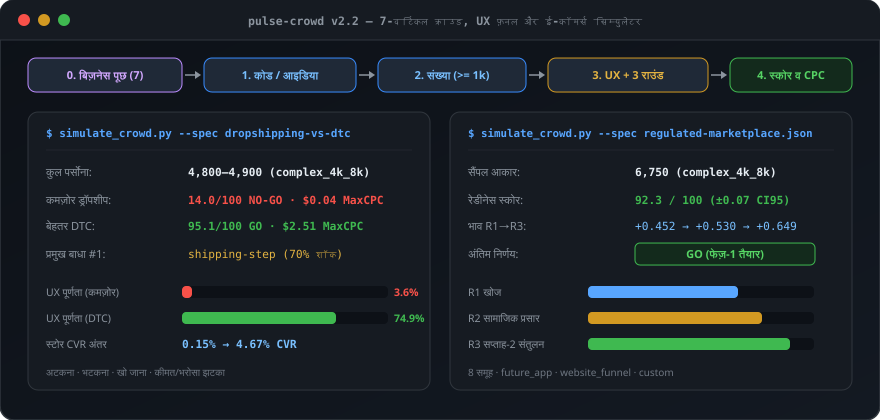

# 🎯 pulse-crowd

> **बाज़ार में उतरने से पहले बाज़ार और अपने ऐप के अंदर का UX समझें।** AI एजेंट्स के लिए गाइडेड, अनुकूली वर्चुअल क्राउड और UX फ़नल सिम्युलेटर (`1,000` से `25,000+` पर्सोना) — पहले पूछता है कि आप कौन-सा बिज़नेस बना रहे हैं (*ड्रॉपशीपिंग, ई-कॉमर्स/DTC, बिना कोड वाला फ़्यूचर ऐप/वेबसाइट, B2B SaaS, मार्केटप्लेस या कस्टम प्रोजेक्ट*), बताता है कि यूज़र्स कहाँ **अटकते**, **भटकते** या **खो जाते** हैं, और विज्ञापन चलाने से पहले CVR व **Break-Even Max CPC** का अनुमान लगाता है।

[English](../../README.md) · [Español](README.es.md) · [简体中文](README.zh-CN.md) · [日本語](README.ja.md) · [한국어](README.ko.md) · [Français](README.fr.md) · [Deutsch](README.de.md) · [Português](README.pt-BR.md) · [Italiano](README.it.md) · **हिन्दी** · [Русский](README.ru.md)

[](https://github.com/SamuelCoreLabs/pulse-crowd/actions/workflows/ci.yml)
[](https://github.com/SamuelCoreLabs/pulse-crowd/releases)


**[📊 लाइव इंटरैक्टिव डेमो](https://samuelcorelabs.github.io/pulse-crowd/)** · **[📦 Releases](https://github.com/SamuelCoreLabs/pulse-crowd/releases)** · **[🌱 Good First Issues](https://github.com/SamuelCoreLabs/pulse-crowd/issues?q=is%3Aissue+is%3Aopen+label%3A%22good+first+issue%22)**



---

## Step 0: गाइडेड इनटेक और 7 बिज़नेस वर्टिकल्स (`v2.1` – `v2.2`)
`"run pulse-crowd"` बोलें (या `python3 scripts/scaffold_spec.py --interactive` चलाएँ): एजेंट पहले आपसे **बिज़नेस का प्रकार** और यह पूछता है कि आपके पास **मौजूदा कोड/Shopify स्टोर** है या **कोड लिखने से पहले का आइडिया** ([audience-playbooks.md](../../references/audience-playbooks.md)):
1. **Dropshipping Store** (`dropshipping_store`) — TikTok/Meta कोल्ड ट्रैफ़िक, `10–25` दिन की डिलीवरी, पॉपअप, छुपा शिपिंग चार्ज और **Break-Even Max CPC**।
2. **E-Commerce / DTC Brand** (`ecommerce_brand`) — रिटर्न पॉलिसी, स्लाइड कार्ट, एक्सप्रेस चेकआउट, Add-to-Cart %, CVR और CPA।
3. **Future Mobile / Web App** *(प्री-कोड)* (`mobile_app`) — पहली स्क्रीन का हुक, शुरुआती साइनअप/KYC, अनुमतियाँ और पेवॉल।
4. **Future Website / Lead Funnel** *(प्री-कोड)* (`website_funnel`) — हीरो कॉपी, सोशल प्रूफ़, प्राइसिंग पारदर्शिता और लीड फ़ॉर्म।
5. **B2B SaaS और DevTools** (`b2b_saas` / `developer_tool`) — डॉक्स, ऑथ/ट्रायल, पहला API कॉल और *Basic/Pro* कन्वर्ज़न।
6. **Marketplaces / Regulated Platforms** (`two_sided_marketplace` / `regulated_platform`) — क्षेत्रीय लिक्विडिटी, GDPR/KYC और `> 15%` सेफ़्टी गेट।
7. **Other / Custom Project (`v2.2`)** (`custom_project`) — एक्सटेंशन, Discord/Telegram बॉट, कोर्स, न्यूज़लेटर, इंडी गेम या लोकल सेवा।

### तुलना: हाई-फ़्रिक्शन ड्रॉपशीपिंग बनाम ऑप्टिमाइज़्ड DTC (`v2.0+`)
| मेट्रिक | ब्रोकन ड्रॉपशीपिंग ([`dropshipping-store.json`](../../examples/dropshipping-store.json)) | ऑप्टिमाइज़्ड DTC ([`ecommerce-dtc-brand.json`](../../examples/ecommerce-dtc-brand.json)) |
| :--- | :--- | :--- |
| **Readiness Score** | **`14.0 / 100`** (`NO-GO`) | **`95.1 / 100`** (`GO`) |
| **UX फ़नल पूर्णता** | **`3.6%`** (`shipping-step` `70.0%` प्राइस शॉक) | **`74.9%`** (`CartDrawer` `10.3%` भटकाव) |
| **CVR / Break-Even Max CPC** | `0.15%` CVR · **`$0.04`** | `4.67%` CVR · **`$2.51`** |

### मुख्य क्षमताएँ
1. **अनुकूली साइजिंग (`scripts/size_swarm.py`):** कम से कम **`1,000`** से लेकर **`25,000+`** वर्चुअल पर्सोना स्वचालित रूप से तय करता है।
2. **स्तरीकृत कोहोर्ट आवंटन:** अनुपालन समीक्षकों और संदेहवादी खरीदारों का सांख्यिकीय प्रतिनिधित्व सुनिश्चित करता है।
3. **3-राउंड सिमुलेशन (`scripts/simulate_crowd.py`):** डिस्कवरी → असमान सोशल कंटेजियन → सप्ताह-2 संतुलन (95% CI)।
4. **स्क्रीन-दर-स्क्रीन UX फ़नल (`ux_journey`):** **अटकना** (`stuck`), **ध्यान भटकना** (`distracted`), **खो जाना** (`lost`) और **कीमत/भरोसा झटका** दिखाता है।
5. **ई-कॉमर्स यूनिट इकोनॉमिक्स (`commerce_profile`):** ATC, कार्ट अबैंडनमेंट, CVR, CPA और Break-Even Max CPC।
6. **सुरक्षा गेट (`0–100`):** यदि `rejected_distrust > 15%`, तो निर्णय `NO-GO` पर सीमित रहता है।

---

## त्वरित इंस्टॉलेशन

```bash
# विकल्प 1: npx skills (Claude Code, Codex, OpenCode, Gemini CLI, Cursor)
npx skills add SamuelCoreLabs/pulse-crowd -g

# विकल्प 2: pip के माध्यम से Python CLI (शून्य बाहरी निर्भरता)
pip install git+https://github.com/SamuelCoreLabs/pulse-crowd.git
pulse-crowd-init --interactive --lang en --out /tmp/my_project_spec.json
pulse-crowd-size --spec examples/minimal-b2b-cli.json
pulse-crowd-sim --spec examples/dropshipping-store.json --out-dir /tmp/pulse_crowd_demo --runs 3 --seed 42
```

### दस्तावेज़ और परीक्षण
- **एजेंट गाइड:** [SKILL.md](../../SKILL.md) · **स्कीमा:** [spec-schema.json](../../references/spec-schema.json) · **पद्धति:** [methodology.md](../../references/methodology.md) · **लाइसेंस:** [MIT](../../LICENSE)
- सत्यापन: `python3 scripts/validate_skill.py` और `python3 -m unittest discover -s tests -v`
