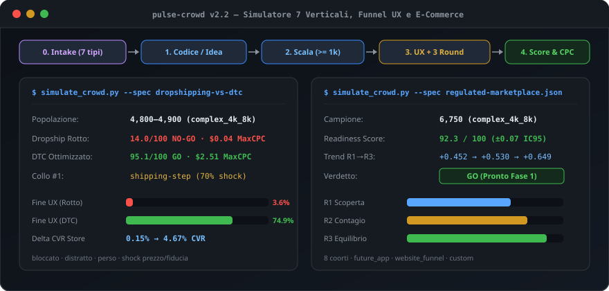

# 🎯 pulse-crowd

> **Comprendi il mercato — e la UX dentro la tua app — prima del lancio.** Simulazione guidata e adattiva di folle virtuali e funnel UX (`1.000`–`25.000+` personas) per agenti IA — chiede prima cosa stai costruendo (*dropshipping, e-commerce/DTC, future app/web pre-codice, SaaS B2B, marketplace o progetti custom*), individua dove gli utenti **si bloccano**, **si distraggono** o **si perdono**, e stima CVR e **Break-Even Max CPC** prima di investire in ads.

[English](../../README.md) · [Español](README.es.md) · [简体中文](README.zh-CN.md) · [日本語](README.ja.md) · [한국어](README.ko.md) · [Français](README.fr.md) · [Deutsch](README.de.md) · [Português](README.pt-BR.md) · **Italiano** · [हिन्दी](README.hi.md) · [Русский](README.ru.md)

[](https://github.com/SamuelCoreLabs/pulse-crowd/actions/workflows/ci.yml)
[](https://github.com/SamuelCoreLabs/pulse-crowd/releases)


**[📊 Demo Interattiva Live](https://samuelcorelabs.github.io/pulse-crowd/)** · **[📦 Releases](https://github.com/SamuelCoreLabs/pulse-crowd/releases)** · **[🌱 Good First Issues](https://github.com/SamuelCoreLabs/pulse-crowd/issues?q=is%3Aissue+is%3Aopen+label%3A%22good+first+issue%22)**



---

## Perché PulseCrowd?

| Approccio | Dimensione campione | Rilevamento rischi di minoranza | Determinismo & IC | Portabilità |
| :--- | :--- | :--- | :--- | :--- |
| **Singolo prompt LLM** | 1 persona generica | Nasconde rischi legali e *cold-start* | Nessuno | Solo prompt |
| **Script fisso 10–15 personas** | ~15 personas fisse | Troppo semplificato o rigido | Ad-hoc | Legato a un solo tool |
| **`pulse-crowd` (Questa Skill)** | **Adattivo `1.000` – `25.000+`** | **Stratificato con soglia statistica** | **Monte Carlo deterministico IC 95%** | **Claude, Codex, Gemini CLI, OpenCode, Cursor, Antigravity** |

### Step 0: Intake Guidato & 7 Verticali di Business (`v2.1` – `v2.2`)
Invocando `"run pulse-crowd"` (o `python3 scripts/scaffold_spec.py --interactive`), la skill chiede prima **cosa stai lanciando** e se esiste già **codice/tema Shopify** o un'**idea pre-codice** ([audience-playbooks.md](../../references/audience-playbooks.md)):
1. **Store Dropshipping** (`dropshipping_store`) — traffico freddo TikTok/Meta, spedizione `10–25` gg., popup, costi nascosti e **Break-Even Max CPC**.
2. **E-Commerce / Brand DTC** (`ecommerce_brand`) — dubbi su taglie/resi, slide-cart, checkout express, ATC, CVR e CPA.
3. **Futura App Mobile / Web** *(pre-codice)* (`mobile_app`) — aggancio iniziale, registrazione/KYC precoce, permessi e paywall.
4. **Futuro Sito Web / Lead Funnel** *(pre-codice)* (`website_funnel`) — chiarezza hero, riprova sociale, prezzi e modulo/prenotazione.
5. **SaaS B2B & Developer Tools** (`b2b_saas` / `developer_tool`) — docs, trial/auth, prima chiamata API e conversione *Basic* vs *Pro*.
6. **Marketplace Bilaterale / Piattaforma Regolata** (`two_sided_marketplace` / `regulated_platform`) — liquidità locale, GDPR/KYC e blocco `> 15%`.
7. **Altro / Progetto Personalizzato (`v2.2`)** (`custom_project`) — estensioni browser, bot Discord/Telegram, corsi, newsletter, giochi indie o servizi locali.

### Caso Studio: Dropshipping ad alto attrito vs. Brand DTC Ottimizzato (`v2.0+`)
| Metrica | Dropshipping con Attrito ([`dropshipping-store.json`](../../examples/dropshipping-store.json)) | Brand DTC Ottimizzato ([`ecommerce-dtc-brand.json`](../../examples/ecommerce-dtc-brand.json)) |
| :--- | :--- | :--- |
| **Readiness Score** | **`14.0 / 100`** (`NO-GO`) | **`95.1 / 100`** (`GO`) |
| **Completamento UX** | **`3.6%`** (`shipping-step` `70.0%` shock prezzo) | **`74.9%`** (`CartDrawer` `10.3%` distrazione) |
| **CVR / Break-Even Max CPC** | `0.15%` CVR · **`$0.04`** *(in perdita a `$0.95`)* | `4.67%` CVR · **`$2.51`** *(profittevole a `$0.85`)* |

### Cosa fa
1. **Dimensionamento adattivo (`scripts/size_swarm.py`):** Garantisce almeno **`1.000` personas** fino a **`25.000+`**.
2. **Allocazione stratificata:** Preserva la rappresentanza statistica di revisori privacy e acquirenti scettici.
3. **Simulazione in 3 round (`scripts/simulate_crowd.py`):** Scoperta → Contagio sociale asimmetrico → Equilibrio settimana 2 & IC 95%.
4. **Funnel UX schermo per schermo (`ux_journey`):** Distingue **bloccati** (`stuck`), **distratti** (`distracted`), **persi** (`lost`) e **shock prezzo/fiducia**.
5. **Unit Economics E-Commerce (`commerce_profile`):** Add-to-Cart, abbandono carrello, CVR, CPA simulato e Break-Even Max CPC.
6. **Soglia di sicurezza (`0–100`):** Blocca il verdetto a `NO-GO` se `rejected_distrust > 15%`.

---

## Installazione rapida

### Opzione 1: Via `npx skills` (Multi-Agente)
```bash
npx skills add SamuelCoreLabs/pulse-crowd -g
```

### Opzione 2: Manuale via Git + Symlink
```bash
git clone https://github.com/SamuelCoreLabs/pulse-crowd.git ~/skills/pulse-crowd
mkdir -p ~/.agents/skills ~/.claude/skills ~/.codex/skills ~/.config/opencode/skills
ln -sfn ~/skills/pulse-crowd ~/.agents/skills/pulse-crowd
ln -sfn ~/skills/pulse-crowd ~/.claude/skills/pulse-crowd
ln -sfn ~/skills/pulse-crowd ~/.codex/skills/pulse-crowd
ln -sfn ~/skills/pulse-crowd ~/.config/opencode/skills/pulse-crowd
```

### Opzione 3: CLI Python via `pip`
```bash
pip install git+https://github.com/SamuelCoreLabs/pulse-crowd.git
pulse-crowd-init --interactive --lang en --out /tmp/my_project_spec.json
pulse-crowd-size --spec examples/minimal-b2b-cli.json
pulse-crowd-sim --spec examples/dropshipping-store.json --out-dir /tmp/pulse_crowd_demo --runs 3 --seed 42
```

### Verifica locale
```bash
python3 scripts/validate_skill.py
python3 -m unittest discover -s tests -v
```

---

## Documentazione e Comunità

- **Specifica Agent Skill:** [SKILL.md](../../SKILL.md) · **Schema JSON:** [spec-schema.json](../../references/spec-schema.json) · **Metodologia:** [methodology.md](../../references/methodology.md)
- **Contribuire:** [CONTRIBUTING.md](../../CONTRIBUTING.md) · **Codice di condotta:** [CODE_OF_CONDUCT.md](../../CODE_OF_CONDUCT.md) · **Sicurezza:** [SECURITY.md](../../SECURITY.md) · **Licenza:** [MIT](../../LICENSE)
