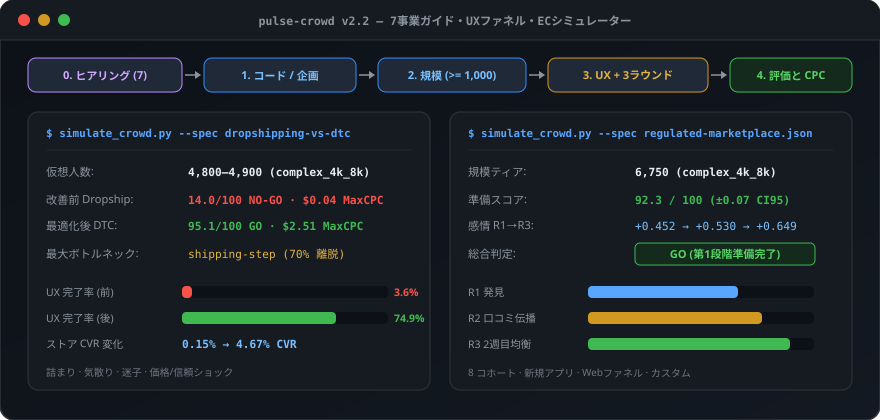

# 🎯 pulse-crowd

> **参入前に市場とアプリ内UXを理解する。** AIエージェント向けのガイド付き適応型仮想群衆・UXファネルシミュレーター（`1,000`〜`25,000+` ペルソナ）— *ドロップシッピング、DTC EC、実装前の新規アプリ/Webサイト、B2B SaaS、マーケットプレイス、カスタム事業* に応じて質問し、ユーザーがどこで**詰まり**・**気散り**・**迷子**になるかを特定し、広告出稿前に CVR と **損益分岐最大 CPC** を試算します。

[English](../../README.md) · [Español](README.es.md) · [简体中文](README.zh-CN.md) · **日本語** · [한국어](README.ko.md) · [Français](README.fr.md) · [Deutsch](README.de.md) · [Português](README.pt-BR.md) · [Italiano](README.it.md) · [हिन्दी](README.hi.md) · [Русский](README.ru.md)

[](https://github.com/SamuelCoreLabs/pulse-crowd/actions/workflows/ci.yml)
[](https://github.com/SamuelCoreLabs/pulse-crowd/releases)


**[📊 インタラクティブデモ](https://samuelcorelabs.github.io/pulse-crowd/)** · **[📦 Releases](https://github.com/SamuelCoreLabs/pulse-crowd/releases)** · **[🌱 Good First Issues](https://github.com/SamuelCoreLabs/pulse-crowd/issues?q=is%3Aissue+is%3Aopen+label%3A%22good+first+issue%22)**



---

## PulseCrowd の特長

| アプローチ | サンプル規模 | 少数派リスク検出 | 再現性と信頼区間 | ポータビリティ |
| :--- | :--- | :--- | :--- | :--- |
| **単一プロンプト** | 汎用 1 ペルソナ | 法務監査や地方のコールドスタートを見逃す | なし | プロンプト依存 |
| **固定 10〜15 人スクリプト** | 固定 ~15 人 | 過小評価または過剰実行 | 場当たり的 | 特定ツール専用 |
| **`pulse-crowd`（本スキル）** | **適応型 `1,000` – `25,000+`** | **層化割当＋最大剰余法による下限保証** | **シード固定 Monte Carlo 95% CI** | **Claude, Codex, Gemini CLI, OpenCode, Cursor, Antigravity** |

### Step 0: ガイド付きヒアリングと 7 つのビジネス領域（`v2.1` – `v2.2`）
`"run pulse-crowd"`（または `python3 scripts/scaffold_spec.py --interactive`）を実行すると、まず**事業の種類**と**既存コード／Shopify テーマか実装前アイデアか**を確認し、最適な検証設計（[audience-playbooks.md](../../references/audience-playbooks.md)）を組み立てます：
1. **ドロップシッピング店** (`dropshipping_store`) — TikTok/Meta 広告、`10–25`日配送、ポップアップ、隠れ送料ショック、**損益分岐 Max CPC**。
2. **Eコマース / DTC ブランド** (`ecommerce_brand`) — サイズ・返品ポリシー、スライドカート、エクスプレス決済、ATC・CVR・CPA。
3. **新規モバイル / Web アプリ** *(コード作成前)* (`mobile_app`) — 初回価値訴求、早期登録/KYC 離脱、権限要求、ペイウォール。
4. **新規 Web サイト / リードファネル** *(コード作成前)* (`website_funnel`) — ファーストビュー明確性、社会的証明、料金透明性、フォーム離脱。
5. **B2B SaaS / 開発者ツール** (`b2b_saas` / `developer_tool`) — ドキュメント、認証/トライアル、初回 API 実行、*Basic/Pro* 転換率。
6. **両面マーケットプレイス / 規制プラットフォーム** (`two_sided_marketplace` / `regulated_platform`) — 地域流動性、GDPR/KYC、`> 15%` 安全ゲート。
7. **その他 / カスタムプロジェクト (`v2.2`)** (`custom_project`) — 拡張機能、Discord/Telegram ボット、講座、ニュースレター、インディーゲーム等。

### ケーススタディ: 高摩擦ドロップシッピング vs 最適化 DTC (`v2.0+`)
| 指標 | 高摩擦ドロップシッピング ([`dropshipping-store.json`](../../examples/dropshipping-store.json)) | 最適化 DTC ストア ([`ecommerce-dtc-brand.json`](../../examples/ecommerce-dtc-brand.json)) |
| :--- | :--- | :--- |
| **Readiness Score** | **`14.0 / 100`** (`NO-GO`) | **`95.1 / 100`** (`GO`) |
| **UX 完了率** | **`3.6%`** (`shipping-step` `70.0%` 価格ショック) | **`74.9%`** (`CartDrawer` `10.3%` 気散り) |
| **CVR / 損益分岐 Max CPC** | `0.15%` CVR · **`$0.04`** *(`$0.95` で赤字)* | `4.67%` CVR · **`$2.51`** *(`$0.85` で黒字)* |

### 主な機能
1. **実行前適応サイジング (`scripts/size_swarm.py`)：** 最小 **`1,000` 人**から **`25,000+` 人**まで自動拡張。
2. **層化コホート配分：** 規制担当者や懐疑的ユーザーの統計的可視性を保持。
3. **3ラウンド伝播シミュレーション (`scripts/simulate_crowd.py`)：** 発見障壁 → 非対称口コミ拡散 → 2週目継続率と 95% 信頼区間。
4. **画面別アプリ内 UX ファネル (`ux_journey`)：** **詰まり** (`stuck`)・**気散り** (`distracted`)・**迷子** (`lost`)・**価格/信頼ショック**を分解。
5. **EC 採算感度分析 (`commerce_profile`)：** カート投入率・カゴ落ち率・推定 CVR・CPA・損益分岐 Max CPC を算出。
6. **安全性ゲート (`0–100`)：** `rejected_distrust > 15%` で自動的に `NO-GO` 判定。

---

## クイックインストール

### オプション 1: `npx skills`（マルチエージェント CLI）
```bash
npx skills add SamuelCoreLabs/pulse-crowd -g
```

### オプション 2: 手動インストール（Git + シンボリックリンク）
```bash
git clone https://github.com/SamuelCoreLabs/pulse-crowd.git ~/skills/pulse-crowd
mkdir -p ~/.agents/skills ~/.claude/skills ~/.codex/skills ~/.config/opencode/skills
ln -sfn ~/skills/pulse-crowd ~/.agents/skills/pulse-crowd
ln -sfn ~/skills/pulse-crowd ~/.claude/skills/pulse-crowd
ln -sfn ~/skills/pulse-crowd ~/.codex/skills/pulse-crowd
ln -sfn ~/skills/pulse-crowd ~/.config/opencode/skills/pulse-crowd
```

### オプション 3: `pip` 経由で Python CLI を導入
```bash
pip install git+https://github.com/SamuelCoreLabs/pulse-crowd.git
pulse-crowd-init --interactive --lang en --out /tmp/my_project_spec.json
pulse-crowd-size --spec examples/minimal-b2b-cli.json
pulse-crowd-sim --spec examples/dropshipping-store.json --out-dir /tmp/pulse_crowd_demo --runs 3 --seed 42
```

### ローカル検証
```bash
python3 scripts/validate_skill.py
python3 -m unittest discover -s tests -v
```

---

## ドキュメントとコミュニティ

- **エージェント仕様:** [SKILL.md](../../SKILL.md) · **JSON スキーマ:** [spec-schema.json](../../references/spec-schema.json) · **手法:** [methodology.md](../../references/methodology.md)
- **貢献する:** [CONTRIBUTING.md](../../CONTRIBUTING.md) · **行動規範:** [CODE_OF_CONDUCT.md](../../CODE_OF_CONDUCT.md) · **セキュリティ:** [SECURITY.md](../../SECURITY.md) · **ライセンス:** [MIT](../../LICENSE)
