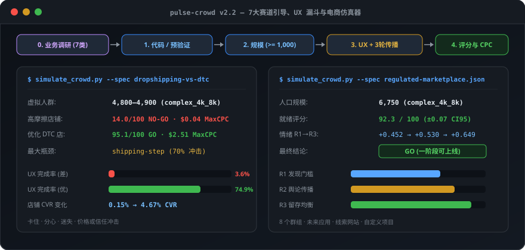

# 🎯 pulse-crowd

> **在进入市场前看清市场与产品内部 UX 漏斗。** 面向 AI 编程代理的引导式自适应虚拟人群与 UX 漏斗仿真器（`1,000` 至 `25,000+` 虚拟用户画像）——先询问你正在搭建的业务类型（*Dropshipping 独立站、DTC 电商、未写代码的未来 App/网站、B2B SaaS、双边平台或自定义项目*），定位用户在哪个页面**卡住**、**分心**或**迷失**，并在投广告或开发前测算转化率与**盈亏平衡最高 CPC**。

[English](../../README.md) · [Español](README.es.md) · **简体中文** · [日本語](README.ja.md) · [한국어](README.ko.md) · [Français](README.fr.md) · [Deutsch](README.de.md) · [Português](README.pt-BR.md) · [Italiano](README.it.md) · [हिन्दी](README.hi.md) · [Русский](README.ru.md)

[](https://github.com/SamuelCoreLabs/pulse-crowd/actions/workflows/ci.yml)
[](https://github.com/SamuelCoreLabs/pulse-crowd/releases)


**[📊 在线交互演示](https://samuelcorelabs.github.io/pulse-crowd/)** · **[📦 GitHub Releases](https://github.com/SamuelCoreLabs/pulse-crowd/releases)** · **[🌱 新手友好议题](https://github.com/SamuelCoreLabs/pulse-crowd/issues?q=is%3Aissue+is%3Aopen+label%3A%22good+first+issue%22)**



---

## 为什么选择 PulseCrowd？

| 方案 | 样本规模 | 少数群体风险发现 | 确定性与置信区间 | 可移植性 |
| :--- | :--- | :--- | :--- | :--- |
| **单条 LLM 提示词** | 1 个泛化角色 | 掩盖合规盲区与冷启动死角 | 无 | 仅限文本提示 |
| **固定 10–15 人测试脚本** | 固定 ~15 人 | 样本过小或算力浪费 | 临时拼凑 | 绑定单一工具 |
| **`pulse-crowd`（本 Skill）** | **自适应 `1,000` – `25,000+`** | **分层抽样 + 最大余数保底** | **固定种子蒙特卡洛 95% CI** | **支持 Claude、Codex、Gemini CLI、OpenCode、Cursor、Antigravity** |

### Step 0：引导式业务诊断与 7 大赛道（`v2.1` – `v2.2`）
调用 `"run pulse-crowd"`（或运行 `python3 scripts/scaffold_spec.py --interactive`），Agent 会先用你的语言询问**正在做的业务类型**，以及当前已有**代码/Shopify 主题**还是处于**零代码规划阶段**（[audience-playbooks.md](../../references/audience-playbooks.md)）：
1. **Dropshipping 店铺**（`dropshipping_store`）— TikTok/Meta 冷启动流量、`10–25` 天物流周期、转盘弹窗、隐藏运费冲击与 **Break-Even Max CPC**。
2. **DTC 品牌电商**（`ecommerce_brand`）— 尺码与退换疑虑、侧边购物车、快捷结账、加购率（ATC）、CVR 与 CPA。
3. **未来移动/Web 应用** *(零代码预验证)*（`mobile_app`）— 首屏价值钩子、过早强制注册/KYC 门槛、权限申请与付费墙。
4. **未来网站 / 线索获客漏斗** *(零代码预验证)*（`website_funnel`）— 首屏清晰度、社会认同、价格透明度与表单/预约流失。
5. **B2B SaaS 与开发者工具**（`b2b_saas` / `developer_tool`）— 文档理解、试用/鉴权、首个 API 调用与 *Basic/Pro* 团队转化。
6. **双边市场与强监管平台**（`two_sided_marketplace` / `regulated_platform`）— 区域冷启动流动性、GDPR/未成年人合规与 `> 15%` 安全闸门。
7. **其他 / 自定义项目（`v2.2`）**（`custom_project`）— 浏览器扩展、Discord/Telegram 机器人、课程、Newsletter、独立游戏、硬件或本地服务。

### 对比案例：高摩擦 Dropshipping vs. 优化后 DTC 品牌店（`v2.0+`）
| 指标 | 高摩擦 Dropshipping（[`dropshipping-store.json`](../../examples/dropshipping-store.json)） | 优化 DTC 品牌店（[`ecommerce-dtc-brand.json`](../../examples/ecommerce-dtc-brand.json)） |
| :--- | :--- | :--- |
| **就绪评分 Readiness** | **`14.0 / 100`**（`NO-GO`） | **`95.1 / 100`**（`GO`） |
| **UX 全流程完成率** | **`3.6%`**（`shipping-step` `70.0%` 价格冲击） | **`74.9%`**（`CartDrawer` `10.3%` 分心） |
| **店铺 CVR / 最高可承受 CPC** | `0.15%` CVR · **`$0.04`** *（`$0.95` 即亏损）* | `4.67%` CVR · **`$2.51`** *（`$0.85` 稳定盈利）* |

### 核心功能
1. **调度前自适应规模计算（`scripts/size_swarm.py`）：** 严格强制 **最低 `1,000` 至 `25,000+` 名虚拟用户**。
2. **分层群体配额：** 最大余数法确保合规审核员、比价人群和批评者保留统计可见性。
3. **三轮社交传染仿真（`scripts/simulate_crowd.py`）：** 发现门槛 → 非对称舆情传播 → 第 2 周留存均衡与 95% 置信区间。
4. **逐屏应用内 UX 漏斗（`ux_journey`）：** 精确定位 **卡住**（`stuck`）、**分心**（`distracted`）、**迷失**（`lost`）与 **价格/信任冲击**。
5. **电商单位经济敏感度（`commerce_profile`）：** 计算加购率、弃购率、店铺 CVR、模拟 CPA 与盈亏平衡最高 CPC。
6. **透明安全闸门（`0–100`）：** 当不信任拒用率 `rejected_distrust > 15%` 时锁定结论为 `NO-GO`。

---

## 快速安装

### 方式一：通过 `npx skills` 全局安装
```bash
npx skills add SamuelCoreLabs/pulse-crowd -g
```

### 方式二：手动克隆并软链接
```bash
git clone https://github.com/SamuelCoreLabs/pulse-crowd.git ~/skills/pulse-crowd
mkdir -p ~/.agents/skills ~/.claude/skills ~/.codex/skills ~/.config/opencode/skills
ln -sfn ~/skills/pulse-crowd ~/.agents/skills/pulse-crowd
ln -sfn ~/skills/pulse-crowd ~/.claude/skills/pulse-crowd
ln -sfn ~/skills/pulse-crowd ~/.codex/skills/pulse-crowd
ln -sfn ~/skills/pulse-crowd ~/.config/opencode/skills/pulse-crowd
```

### 方式三：通过 `pip` 安装 Python CLI
```bash
pip install git+https://github.com/SamuelCoreLabs/pulse-crowd.git
pulse-crowd-init --interactive --lang en --out /tmp/my_project_spec.json
pulse-crowd-size --spec examples/minimal-b2b-cli.json
pulse-crowd-sim --spec examples/dropshipping-store.json --out-dir /tmp/pulse_crowd_demo --runs 3 --seed 42
```

### 本地验证
```bash
python3 scripts/validate_skill.py
python3 -m unittest discover -s tests -v
```

---

## 技术文档与社区

- **Agent Skill 规范：** [SKILL.md](../../SKILL.md) · **JSON Schema：** [spec-schema.json](../../references/spec-schema.json) · **方法论：** [methodology.md](../../references/methodology.md)
- **参与贡献：** [CONTRIBUTING.md](../../CONTRIBUTING.md) · **行为准则：** [CODE_OF_CONDUCT.md](../../CODE_OF_CONDUCT.md) · **安全政策：** [SECURITY.md](../../SECURITY.md) · **许可证：** [MIT](../../LICENSE)
